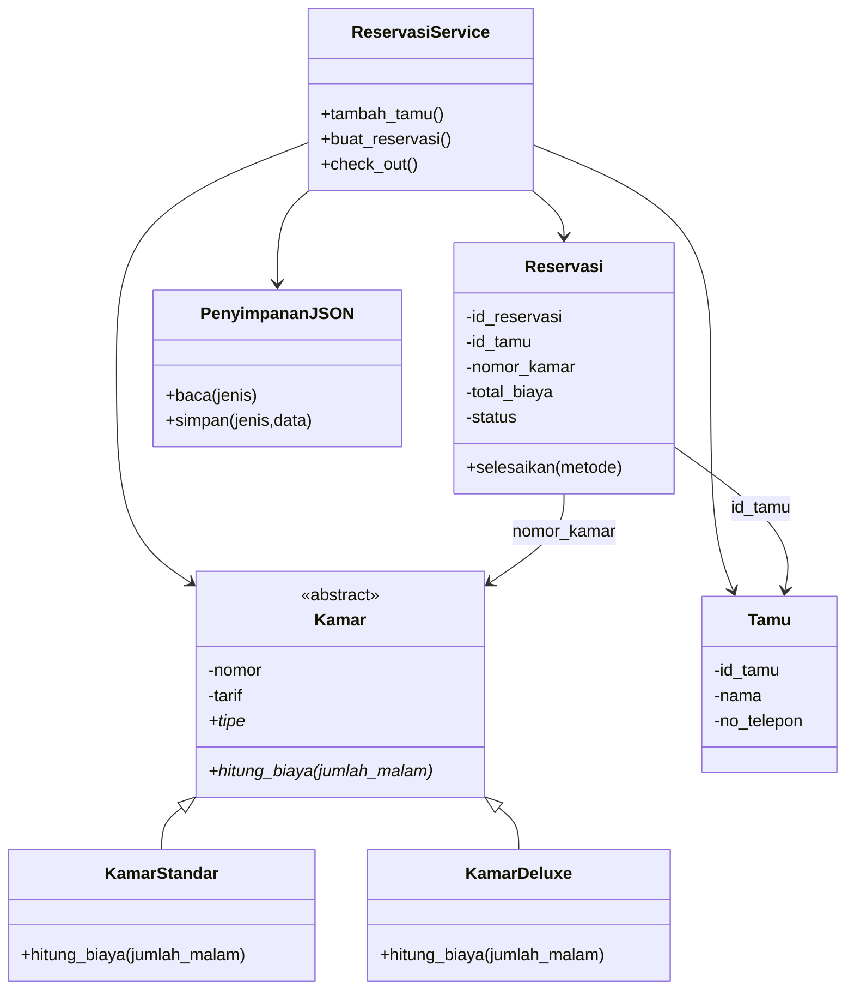

# Sistem Reservasi Penginapan (Versi Sederhana)

Aplikasi Python berbasis terminal (CLI) untuk mengelola tamu, reservasi kamar Standar/Deluxe, dan check-out/pembayaran.

## Kebutuhan
- Python 3.10 atau lebih baru
- Tidak memerlukan library tambahan

## Menjalankan aplikasi
Buka terminal pada folder proyek, lalu jalankan:

```bash
python main.py
```

Pada Windows, jika perintah `python` tidak tersedia, gunakan:

```bash
py main.py
```

## Menjalankan pengujian

```bash
python -m unittest -v uji_skenario.py
```

Pengujian mencakup lima skenario positif dan satu skenario input tidak valid.

## Fitur
1. Melihat kamar Standar dan Deluxe.
2. Mendaftarkan tamu.
3. Membuat reservasi berdasarkan tanggal.
4. Menghitung biaya berdasarkan jenis kamar dan jumlah malam.
5. Memeriksa bentrok tanggal untuk kamar yang sama.
6. Check-out dan mencatat metode pembayaran.
7. Melihat riwayat reservasi.

## Aturan bisnis
- Check-in harus hari ini atau tanggal setelah hari ini.
- Check-out harus setelah tanggal check-in.
- Satu kamar tidak dapat memiliki dua reservasi aktif dengan tanggal yang bertabrakan.
- Tarif kamar Standar = tarif dasar per malam.
- Tarif kamar Deluxe = (tarif dasar + Rp50.000 sarapan) per malam.
- Metode pembayaran: TUNAI, TRANSFER, atau KARTU.
- Check-out mengubah status reservasi dari DIPESAN menjadi SELESAI.

## Penyimpanan
Data disimpan secara permanen pada:
- `data/kamar.json`
- `data/tamu.json`
- `data/reservasi.json`

Data tetap tersedia setelah aplikasi ditutup dan dibuka kembali.

## Struktur folder
- `models/`: class Kamar, Tamu, dan Reservasi.
- `services/`: proses bisnis reservasi.
- `utils/`: pembacaan dan penulisan JSON.
- `data/`: data contoh.
- `main.py`: menu terminal dan titik awal aplikasi.
- `uji_skenario.py`: pengujian otomatis.

## Penerapan OOP
- Encapsulation: atribut objek menggunakan atribut internal dan property.
- Abstraction: `Kamar` merupakan abstract class.
- Inheritance: `KamarStandar` dan `KamarDeluxe` mewarisi `Kamar`.
- Polymorphism: kedua subclass memiliki implementasi `hitung_biaya()` yang berbeda.

## Class Diagram (Mermaid)



Catatan: diagram ini disediakan sebagai rancangan awal dan harus tetap disesuaikan jika kode diubah.
